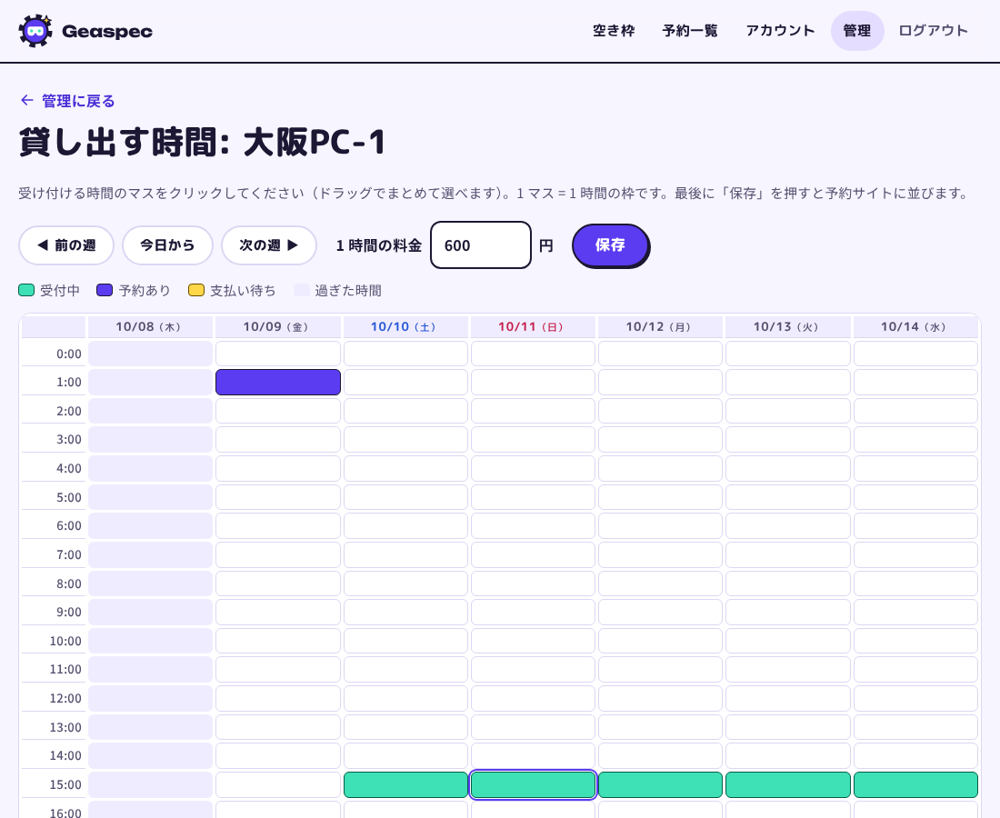

# Geaspec（ギアスペック）

ゲーミングPCを持っていない Quest ユーザーが、貸し手の PC にインターネット越しにつないで PC 版 VRChat を遊べるしくみです。

> **これは、お金もうけを目的としない、コミュニティ限定の実験的な取り組みです。**
> 利用はすべて無料で、運営も貸し手も利用する人からお金を受け取りません。予約サイトは、Discord のボットから届く本人専用のリンクを開いた人だけが使えます。
> 実験のため、予告なく内容を変えたり終了したりすることがあります。

## ライセンス

このプログラムは [GNU Affero General Public License v3.0](LICENSE)（AGPL-3.0）で公開しています。
だれでも無料で使い、改造し、配ることができます。改造したものでサービスを動かす場合は、改造したプログラムも同じライセンスで公開してください。

予約サイトは「無料の実験」として動きます。料金の表示や支払いはありません。
（開発の初めに作った支払いのプログラムが中に残っていますが、このプロジェクトでは使わず、止めてあります。）

| ディレクトリ | 中身 |
| --- | --- |
| `server/` | Webサイト・予約・管理画面・Agent API・テスター用 Discord ボット（Python / FastAPI） |
| `agent/` | 貸し手 PC で動く Agent（Windows / Python 標準ライブラリ + psutil） |
| `docs/` | 画面のスクリーンショット |

## 仕組み

```
 借り手 (Quest)                    サーバー (Webサイト)                 貸し手 PC (Agent)
 ─────────────                    ──────────────────                 ─────────────────
 ① 枠を選んで予約（無料） ──────▶  予約を確定し VPN キーを発行 (Tailscale API)

 ② 予約ページで VPN キーを確認 ◀──
                                                         ◀── ③ 15秒ごとに「次の仕事は？」
                                  開始 2 分前に「開始」を返す ──▶ 痕跡削除 → VD 起動 → VRChat 起動
 ④ VPN をオン → Virtual Desktop で接続 → 自分の VRChat アカウントでログイン
                                                              ⑤ 終了時刻: 全プロセス終了・痕跡削除
                                  完了報告を受け取る      ◀────── レポートを送信
                                  VPN キーと借り手端末を削除
```

- **貸し手 PC はホームルーターの内側にあるため、サーバーから PC へは接続しません。** Agent の側から定期的に問い合わせます（ポーリング）。ポート開放は不要です。
- 運営が予約をキャンセルすると、Agent はセッション中でも 30 秒以内に気づいて終了します。
- Agent が落ちて再起動した場合は、利用中の予約を再開します。終了時刻を過ぎていれば後片付けをして報告します。
- PC がオフラインのまま開始できなかった予約は「期限切れ」となり、管理画面に表示されます。

### スクリーンショット

1. セッション中に VRChat で撮った写真は、貸し出し専用ユーザーのピクチャに一時保存されます。
2. 終了時に Agent が VRChat を閉じ、写真を zip にまとめてサーバーへ送信してから、PC 上の写真を削除します。
3. 借り手は予約ページから **7 日間**ダウンロードできます。期限が来るとサーバーからも自動で削除されます。
4. ダウンロードできるのは**借り手本人だけ**です。運営（管理画面）には枚数だけが表示されます。

送信に失敗しても PC からは削除します（借り手のデータを貸し手 PC に残さないことを優先）。

### 試作版で隠している機能

フォロー・貸し手の紹介ページと評価・「アプリとして使う」は、試作版では隠しています（`SIMPLE_MODE`。データは消えません）。

### 1 時間の流れ（片づけと次の準備）

1 時間の枠は **00〜55 分が利用時間**です。最後の 5 分で、借り手のデータを消して、次の人のために VRChat などを起動しておきます。

| 時刻 | 何をするか |
| --- | --- |
| 前の時間の 55 分 | （前の予約がなければ）準備を始める。借り手はこの時点からつなげる |
| 00〜55 分 | 利用時間 |
| 55〜57 分ごろ | 片づけ（VRChat を閉じる・データを消す・写真を送る） |
| 57〜00 分 | 次の予約があれば、次の人の準備 |

予約が続いていても、次の人は毎時 00 分ちょうどに始められます。5 分は `TURNOVER_MINUTES` で変えられます（10 分以下の短い枠は削りません）。

### 予約の状態

`予約確定` → `利用中` → `終了`。途中で `キャンセル` / `期限切れ` になることもあります。

## 予約サイトを自分の PC で公開する

お金をかけずに始めるため、予約サイトは運営の Windows PC で動かし、Tailscale の「Funnel」という機能でインターネットに公開します。**その PC がついている間だけ**サイトが見られます。

1. その PC に Tailscale を入れて、ログインしておきます（VPN で使っているものと同じです）。
2. [Releases](../../releases) から `GeaspecSite-x.y.z.zip` をダウンロードして、好きな場所に展開します。
3. 中の `GeaspecSite.cmd` をダブルクリックします。
   - 青い画面「Windows によって PC が保護されました」が出たら、「詳細情報」→「実行」で進めます（署名をしていないために出ます）。
   - はじめてのときは、管理者のメールアドレス、サイトの合言葉、お知らせメールの送り元にする Gmail を聞かれます（メールを送らないなら Enter で飛ばせます）。
   - Tailscale のリンクが出たら、ブラウザで開いて「許可」を押します（Funnel を使う許可。最初の 1 回だけ）。
4. 黒い画面に **サイトのアドレス**（`https://〇〇.ts.net`）が出ます。これを貸し手・借り手に伝えます。
5. 管理者のメールアドレスでサイトに登録すると、「管理」画面が使えます。

- 黒い画面を閉じると、サイトも止まります。
- 予約やアカウントのデータは `%LocalAppData%\GeaspecSite` に保存されます。新しい版の zip に入れ替えても消えません。
- お知らせメールは、Gmail の「アプリ パスワード」で送ります。作り方: Google アカウントで 2 段階認証をオンにし、https://myaccount.google.com/apppasswords で名前に Geaspec と入れて「作成」を押し、出てきた 16 文字を黒い画面に入れます。送るのは「予約が確定した（借り手）」「新しい予約が入った（貸し手）」「PC が確認待ち（運営）」「PC を承認した（貸し手）」「利用が終わった（借り手）」の 5 つです。管理画面の「テストメールを送る」で届くか確かめられます。設定し直すときは `site_config.json` の `mail_user` と `mail_password` を消して起動し直します。
- 貸し手のアプリには、`agent/server_url.txt` に書いたサイトのアドレスが組み込まれます。貸し手はアドレスを入れずにログインするだけです。アドレスが変わったら、このファイルを書き換えて新しい版を出します。

## 貸し手の登録

1. 貸し手は、予約サイトでアカウントを作ります（借りる人と同じ手順です）。
2. 貸し出し専用の Windows ユーザーで Geaspec Agent をインストールし、そのメールアドレスとパスワードでログインします。インストーラーを開いて青い画面「Windows によって PC が保護されました」が出たら、「詳細情報」→「実行」で進めます。
3. 運営の管理画面に、その PC が **承認待ち** で出ます。接続先（Tailscale の IP）と借り手タグを入れて「承認する」を押すと、貸し出せるようになります。
   - 承認前でも、貸し手はカレンダーで貸し出す時間を選んでおけます（承認されるまでは借り手には見えません）。

## テスター用 Discord ボット

テスターが Discord のボタンだけで「申し込み → テスト開始 → 計測 → アンケート」まで自分で進められます。記録は自動でたまり、運営はコマンド 1 つで集計と CSV を受け取れます。ボットは予約サイトと同じ黒い画面の中で動きます（画面を閉じるとボットも止まります）。

**テスターから見た流れ**

1. 申し込みチャンネルの「🙋 テスターに申し込む」を押して、VRChat の名前・Meta ユーザー名・機材・地方を書く
2. 本人と運営だけが見られる専用スレッドができる。グループ（Quest だけ／PCVR／いい PC）と、VD を持っているかをえらぶ
3. 2つをえらぶと、運営を待たずにスレッドへ予約サイトの本人専用リンクと「▶ テストを始める」が届く（VD を持っていない人には入れ方も出す）。運営は、予約が入るまでに LG の VD Streamer にその人の Meta ユーザー名を入れておく（予約が入ったときと 15 分前に、運営チャンネルでも知らせる）
4. 当日、「▶ テストを始める」→ VD でつなぐ →「✅ ワールドに入れた」。ここまでの時間が自動で記録される。困ったら「🆘 困った」で運営が呼ばれる
5. 遊んでいる途中: VRChat の Launchpad → 設定 → 一番下で FPS と Ping を表示し、決めたワールド（3 つまで）のスポーン地点で 30 秒立って数字を入れる（スクショをスレッドに貼るだけでもよい）
6. 「🏁 遊び終わった」→ ボタンで答えるアンケート 10 問 → ひとこと（任意）→ **評価フォーム**（サイトの `/feedback`。サイトの見た目・名前・使いやすさの 6 段階評価、都道府県・回線の速さ・Wi-Fi・遊び方・払ってもいい金額・我慢できる FPS など）
7. 3 日後、スレッドに 3 問だけ届く（また使いたいか・友達に話したか・払ってもいい金額）

準備ができたときの案内は、グループで変わります。A・B（借りる側）には予約の手順と「✅ 予約できた」「🆘 予約で迷った」ボタン（準備から予約までの時間を記録）、C（いい PC を持っている人）には貸し手としての聞き取りと、貸し手ベータ（Geaspec アプリ）のダウンロード手順が届きます。申し込みチャンネルと案内には「テストができる時間」（はじめは「平日は19時以降、土日は終日」）を書きます。

**運営が受け取るもの**

- 運営チャンネルに、申し込み・テスト開始・「困った」・テスト完了（結果の要点）のお知らせが届く
- 予約サイトで予約が入ると、運営チャンネルとテスターのスレッドに日時が届く（サイトの Meta ユーザー名と、申し込みの Meta ユーザー名でつなぐ）。開始 15 分前にはテスターに「まもなく」、運営には確認すること（PC の電源・Geaspec アプリ・VD Streamer の「Allow remote connections」）が届き、PC のアプリから 5 分以上連絡がなければ注意が出る。キャンセルも運営に届く
- 新しい版の GeaspecSite を起動すると、名前に「更新情報」を含むチャンネル・スレッド・フォーラムに、その版の変更点とダウンロードのリンクを 1 回だけ書く（変更点は `server/app/version.py` の `CHANGES` に書く）
- 評価フォームの答えは、サイトの管理画面「評価フォーム」（`/admin/feedback`）で平均と表を見られる。`/geaspec-results` の表にも、テストの回ごとに右側につながる
- `/geaspec-link`: 運営が予約サイトに入るための自分用リンクを受け取る（合言葉がないため）。`member:@テスター` を付けると、その人のスレッドに本人専用のリンクを送る（0.7.9 より前に準備ができた人向け）
- `/geaspec-news`: いま動いている版を確かめ、その版の変更点を「更新情報」チャンネルにもう一度書く。新しい版に入れ替えたのにお知らせが出ないときに使う
- `/geaspec-results`: テスト計画書の目標（つながった割合 90%、入るまで 5 分以内、満足度 4 以上、また使いたい 70% など）と比べた集計と、Excel で開ける CSV
- `/geaspec-erase`: テストが終わったら、名前・Meta ユーザー名などを消す（アンケートの答えと時間は残る）
- データの場所: `%LocalAppData%\GeaspecSite\tester_bot.db`、スクショは `tester_screenshots` フォルダ。CSV に Meta ユーザー名は出ません

**はじめに 1 回だけやること**

1. https://discord.com/developers/applications を開き、「New Application」で `Geaspec` を作る
2. 「Bot」で「トークンをリセット」→「コピー」でトークンを控える（人に見せない）。同じ画面の「メッセージコンテントインテント」をオンにして保存する（スクショの記録に使います）
3. 「OAuth2」→「OAuth2 URL ジェネレーター」で、スコープの `bot` と `applications.commands` にチェック。Bot の権限は次の 11 個にチェックして、生成された URL を開き、Geaspec サーバーに追加する
   - ロールの管理／チャンネルの管理／チャンネルを表示／メッセージを送る／プライベートスレッドを作成／Threadsでメッセージを送る／スレッドを管理／リンクを埋め込み／ファイルを添付／メッセージ履歴を読む／リアクションを付ける
   - すでに追加してある場合は、サーバー設定 → ロール → Geaspec（ボットの名前のロール）→ 権限 で「ロールの管理」「チャンネルの管理」をオンにするだけでよい
4. `GeaspecSite.cmd` を起動すると「Discord ボットのトークン」を聞かれるので、2 で控えたものを貼る（すでに使っている人も、次の起動で 1 回だけ聞かれます）

テスターは LG の家の外からつなぐので、LG の Virtual Desktop Streamer で「Allow remote connections」（外からの接続を許可）に必ずチェックを入れておきます。

ボットがはじめて動くと、次を自動で用意します（同じ名前のものがあれば、それを使います）。
- 「運営」ロール（@mention 可）。サーバーの持ち主に付ける
- `運営` チャンネル（運営ロールだけが見られる）。お知らせが届く
- `🙋テスター申し込み` チャンネル（テスターはボタンを押すだけ。自分のスレッドの中では書ける）と、申し込みボタン

FPS を測るワールドははじめ「日本語話者向け集会場」「Japan Shrine」「Nagisa」の 3 つ（`/geaspec-setup worlds:A, B, C` で 3 つまで変えられる）、テストができる時間は `/geaspec-setup hours:…` で決めます。VD の一覧に出る PC の名前ははじめ `LG`。違うときは `/geaspec-setup pc_name:名前` で変えられます。チャンネルを消してしまったときも `/geaspec-setup` で作り直せます（`here:True` にすると、実行したチャンネルにボタンを置きます）。自動の準備が終わったら、ボットの「ロールの管理」「チャンネルの管理」はオフに戻してもかまいません。

## 開発環境で動かす

```bash
cd server
pip install -r requirements-dev.txt
SECRET_KEY=dev ADMIN_EMAILS=you@example.com uvicorn app.main:app --reload
```

`http://localhost:8000` を開き、`ADMIN_EMAILS` に指定したメールアドレスで登録すると「管理」メニューが出ます。

1. PC を登録する（貸し手が Agent からログインして運営が承認する。または管理画面で PC を追加して、表示された接続コードを Agent の「詳しい設定」に貼る）
2. 貸し出す時間を決める（貸し手が Agent のカレンダーで選ぶか、管理画面の PC の「貸し出す時間」で選ぶ）
3. 別のアカウントで登録 → Meta ユーザー名を設定 → 予約
4. Agent をサーバーモードで起動する（Windows 以外では `--dry-run` で動作確認できます）

```bash
cd agent
PCVR_AGENT_TOKEN=pcvr_xxx python host_agent.py --server http://localhost:8000 --dry-run
```

テスト:

```bash
cd server && python -m pytest
cd agent && python -m unittest discover -s tests
```

### 貸し出す時間（カレンダー）

1 マス = 1 時間の枠として、1 週間のカレンダーで選びます。貸し手は Agent の画面から、運営は管理画面から同じことができます。



- 外した時間の枠は消えます。予約が入っている枠は外せません。
- 予約が入ると、借り手の予約ページと貸し手の Agent に「あと何分で Geass を開始します」と表示されます。

## 設定（環境変数）

| 変数 | 説明 | 既定値 |
| --- | --- | --- |
| `SECRET_KEY` | ログイン用の秘密鍵。**本番では必ず長いランダム値に** | （未設定なら起動ごとに生成） |
| `BASE_URL` | 公開 URL（接続コードやリンクに入る URL）。`https://` なら Cookie を Secure にする | `http://localhost:8000` |
| `SIMPLE_MODE` | `1`（はじめから）だと試作版としてシンプルに見せ、フォロー・貸し手の紹介ページと評価・「アプリとして使う」を隠す。`0` で元に戻る（データは消えない） | `1` |
| `INVITE_ONLY` | `1` にすると、Discord のボットが渡す本人専用リンク（14日有効）を開いた人だけがサイトを見られる。`GeaspecSite.cmd` は Discord ボットを使うとき自動で `1` にする（設定ファイルに `"invite_only": false` と書くと合言葉に戻る） | `0` |
| `SITE_PASSWORD` | 設定すると、サイト全体に合言葉をかける（招待した人だけが見られる）。Agent からの通知は合言葉なしで届く | なし |
| `ADMIN_EMAILS` | 管理者のメールアドレス（カンマ区切り） | なし |
| `DATABASE_URL` | データベース | `sqlite:///./pcvr.db` |
| `SMTP_USER` / `SMTP_PASSWORD` | お知らせメールの送り元（Gmail アドレスとアプリ パスワード）。未設定ならメールは送らない | なし |
| `SMTP_HOST` / `SMTP_PORT` / `MAIL_FROM` | Gmail 以外で送るとき | `smtp.gmail.com` / `587` / `SMTP_USER` |
| `SERVICE_NAME` | サービス名 | `Geaspec` |
| `MEDIA_DIR` | 借り手のスクリーンショットの保存先（本番では永続ディスクにする） | `./media` |
| `SCREENSHOT_DAYS` | スクリーンショットを保存しておく日数 | 7 |
| `SCREENSHOT_MAX_MB` | 1 回のセッションで受け取るスクリーンショットの上限 | 250 |
| `VPN_MODE` | `manual`（運営が手作業で招待）/ `tailscale` | `manual` |
| `TAILSCALE_API_KEY` / `TAILSCALE_TAILNET` | Tailscale の API キーと tailnet 名 | `-`（既定の tailnet） |
| `TURNOVER_MINUTES` | 枠の最後の何分を片づけと次の人の準備にあてるか | 5 |
| `AGENT_START_LEAD_SECONDS` | 開始時刻の何秒前に Agent へ開始を指示するか（VD の受け側と VRChat を先に起動しておく） | 300 |

### Tailscale

貸し手 PC ごとに、PC 用と借り手用の 2 つのタグを作ります。ACL で「借り手はその PC にだけ届く」ようにします（ポリシーファイルの例）。

```jsonc
{
  "tagOwners": {
    "tag:host-pc1":     ["autogroup:admin"],
    "tag:borrower-pc1": ["autogroup:admin"]
  },
  "acls": [
    // 運営 (管理者) は全部に届く
    { "action": "accept", "src": ["autogroup:admin"], "dst": ["*:*"] },
    // 借り手は自分が借りた PC にだけ届く。VD の使用ポートを確認したら絞る
    { "action": "accept", "src": ["tag:borrower-pc1"], "dst": ["tag:host-pc1:*"] }
  ]
}
```

管理画面で PC を追加するときに、次の2つを入力します。
- 接続先: 貸し手 PC の Tailscale IP
- 借り手タグ: `tag:borrower-pc1`

予約が確定すると、サーバーが次のキーを発行します。
- 1回限り
- 一時的（ephemeral）
- 借り手タグ付き
- 終了時刻まで有効

終了時には、キーとタグの付いた端末を削除します。

## 本番公開に向けて（未対応・要確認）

- [ ] **規約の確認**: Steam・VRChat・Virtual Desktop の規約で、PC の貸し出しに使ってよいか
- [ ] **Virtual Desktop の接続許可ユーザーの自動設定**: 設定の保存場所を実機で調べて実装する。現在は運営が手動で設定し、Agent はレポートに警告を残す
- [ ] **Quest への Tailscale 導入手順**の確認と、借り手向け案内ページの作成
- [ ] **法的ページの文面**: 実験用の利用規約・プライバシーポリシーは、いまは簡単なもの
- [ ] **ホスティング**: 公開先は Render や Fly.io など。SQLite を使う場合は永続ディスクが必要。PostgreSQL に移す場合は `psycopg` を追加する
- [x] メール通知（予約確定・新しい予約・PC の確認待ち／承認・利用の終了）
- [ ] パスワードリセット、開始前リマインド・トラブル時の連絡メール
- [ ] VRChat の起動タイミング: いまは借り手の接続前に起動するので、デスクトップモードで立ち上がる可能性がある。実機で確認して、接続を検知してから起動するなどに直す
- [ ] 空き枠がないときの入荷通知の登録
- [ ] ログイン試行の回数制限、CSRF トークン（現在は Cookie の SameSite=Lax で防いでいる）
- [ ] 貸し手の募集・登録（現在は運営が PC を登録する前提）
