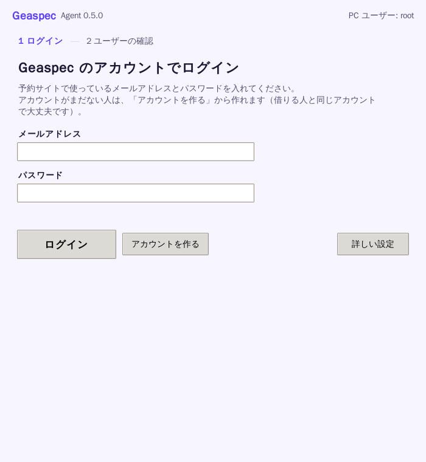
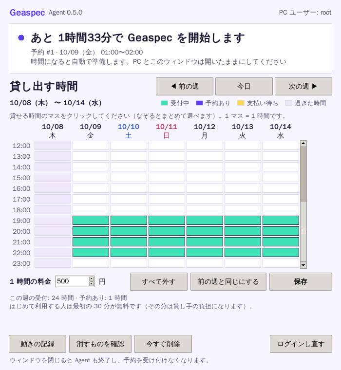

# Geaspec Host Agent

Geaspec の**貸し手PC**で動く Agent です（Windows 11 / Python 3.10+）。
セッションの前後で VRChat / SteamVR / ストリーマー（Virtual Desktop または ALVR）を終了し、借り手の痕跡（ログイン情報、Cookie、ログ、キャッシュ、スクリーンショット）を削除します。

```
python host_agent.py --duration 30                 # 時間を指定して 1 回だけ
python host_agent.py --server https://example.com  # 予約サイトの指示で自動運転
```

## インストール（貸し手 PC）

1. **貸し出し専用の Windows ユーザー**でサインインします。
2. GitHub の **Releases** から `GeaspecAgent-Setup-x.y.z.exe` をダウンロードして実行します。
   - 「Windows によって PC が保護されました」と出たら、「詳細情報」→「実行」を押してください。署名なしのアプリのためです。
   - ユーザーごとのインストールなので、管理者権限の確認（「このアプリがデバイスに変更を加えることを許可しますか」）は通常出ません。
3. 質問の画面は出ずにそのままインストールされ、終わるとアプリが開きます。サインインしたときにも自動で開くので、PC をつけるだけで待機を始めます。
4. アプリが開いたら、予約サイトで作った **Geaspec のアカウント**（メールアドレスとパスワード）でログインします。
5. 貸し出し専用ユーザーの確認にチェックを入れて「登録してはじめる」を押します。
6. 同じ画面のカレンダーで、貸せる時間のマスをクリックして「保存」を押します。
7. 運営が承認すると、借り手から予約できるようになります（それまでは「運営の確認待ちです」と出ます）。



### 画面の見かた



| 画面の要素 | 内容 |
| --- | --- |
| 状態 | 「あと 23分で Geass を開始します」（次の予約まで）／利用中（残り時間）／運営の確認待ち など。新しい予約が入ると、ウィンドウが前に出て音が鳴ります |
| 貸し出す時間 | 1 週間のカレンダーで、貸せる時間を選ぶ |
| 動きの記録 | カレンダーの場所に、アプリが何をしたかの記録を出す（もう一度押すとカレンダーに戻る） |
| 消すものを確認 | 消す予定のフォルダを表示するだけ（何も消しません） |
| 今すぐ削除 | VRChat などを閉じて、ログインの情報や一時ファイルを消す（利用中は押せません） |
| ログインし直す | 別のアカウントでログインするときなど |

ウィンドウは 1 つだけです。はじめての設定もカレンダーも、同じウィンドウの中に出ます。

- 1 マス = 1 時間の枠です。ドラッグでまとめて選べます。「前の週と同じにする」で毎週の予定をすぐ作れます。
- 予約が入っている時間（紫）は外せません。
- ウィンドウを閉じると Agent も終了します。利用中に閉じると、セッションを終えて後片付けをしてから閉じます。
- 二重に起動しないようになっています（予約を二重に処理しないため）。
- コマンドで使いたい場合は、これまでどおり `python\python.exe host_agent.py --help` が使えます。

### 安全のための仕組み

- **貸し出し専用ユーザーの登録**: 初めて起動したときに削除するものの一覧を表示し、確認のチェックを入れたユーザーだけを貸し出し専用として登録します。登録されていないユーザーでは、削除を一切行いません（「削除対象の確認」は登録なしで使えます）。
- **写真は借り手に届けてから削除する**: 終了時に、セッション中に撮った VRChat の写真を予約サイトへ送信し、その後 PC から削除します。
- **利用中はパソコンの画面を幕で覆う**: 利用中と後片付け中は、全部のモニターを「Geass 利用中」の幕で覆います。幕には大きな残り時間（例: 42:13）、終了時刻、残りのバーを出し、残り 5 分で黄色に変わります。借り手が Virtual Desktop でパソコンの画面を開いても、デスクトップやアイコン、他のアプリは見えません。VR の映像は SteamVR から Quest に直接届くので、遊ぶのには影響しません。借り手が VR の中で SteamVR を閉じると VRChat も閉じるため、10 秒後に VRChat（と SteamVR）が自動で起動し直します。幕に閉じるボタンはありません。利用を途中で止めるときは、予約サイトの管理画面でその予約をキャンセルします（アプリが自動で終わらせます）。
- **VR の中に残り時間**: 利用中は、左手の手首のあたりに「残り 42分」と表示します（左手が見つからないときは視界の左下）。残り 10分・5分・1分になると、目の前に数秒だけお知らせが出ます。SteamVR の上に重ねて表示するので、VRChat のほかの人には見えません。
- **VRChat の外に出られない**: 借り手が VRChat を閉じると、10 秒後にもう一度起動します。利用中は、そのユーザーではタスクマネージャーも開けません（終わると元に戻します）。
- **クラウド同期フォルダは削除しない**: OneDrive・Dropbox・Google ドライブなどに同期されるフォルダの中にある対象は削除せず、「要確認」として報告します。消すとクラウド側からも消えてしまうためです。借り手のスクリーンショットが残らないよう、**OneDrive と連携していないローカルユーザー**を使ってください。

設定は `%LocalAppData%\GeaspecAgent\config.json` に保存されます。トークンが含まれるので、他人に渡さないでください。

インストーラーを使わない場合は、`portable.zip` を展開して `GeaspecAgent.cmd` をダブルクリックしてください。

> 0.2.1 から、自前の exe ではなく**署名付きの公式 Python（埋め込み版）**を同梱して Agent を動かしています。署名のない exe は Windows Defender に誤検知されやすいためです。

### リリースの作り方（運営向け）

1. `agent/host_agent.py` の `AGENT_VERSION` を上げる（例: `0.1.0` → `0.2.0`）
2. その変更を main に取り込む（PR をマージする）
3. GitHub Actions がテスト → exe ビルド → インストーラー作成を行い、タグ `agent-v<バージョン>` を作って Releases に公開する

バージョンを上げずに main を更新した場合は、公開済みのリリースはそのまま残ります（上書きしません）。

ブランチへの push や PR でもビルドは走ります。成果物は Actions の実行結果ページ（Artifacts）から取得できます。

## サーバーモード

管理画面で PC を追加して発行された Agent トークンを設定し、`--server` で起動します。

```
set PCVR_AGENT_TOKEN=pcvr_xxx
python host_agent.py --server https://example.com --vpn-interface Tailscale
```

- 15 秒ごとにサーバーへ問い合わせます。貸し手 PC 側でポート開放は不要です。
- 予約の開始 2 分前に、自動で準備と起動を行います。
- 終了時刻になると後始末をし、レポートをサーバーへ送ります。
- 運営が予約をキャンセルすると、セッション中でも 30 秒以内に終了します。
- トークンが無効な場合は終了します（終了コード 2）。

Windows のスタートアップやタスクスケジューラに登録しておくと、PC の起動時から待機できます。

## 処理の流れ

| 段階 | 内容 |
| --- | --- |
| `check_vpn` | `--vpn-interface` で指定した VPN が有効か確認。無効なら何もせず終了（終了コード 2） |
| `prepare_session` | VRChat → SteamVR → ストリーマーの順にプロセスを終了し、痕跡を全削除 |
| `start_session` | ストリーマー（既定は Virtual Desktop）を起動し、2秒後に VRChat を起動 |
| `wait_for_session` | 指定時間まで待機。残り 30/10/5/1 分でログ。VPN 切断も検知してログ |
| `cleanup_session` | 再度プロセスを終了し、痕跡を全削除。レポートを保存 |

`Ctrl+C`、コンソールウィンドウの×、ログオフ、シャットダウンのいずれでも `cleanup_session` が走ります。
ウィンドウを閉じた場合は Windows が約5秒で強制終了するため、削除しきれなかった分は**次回起動時の `prepare_session` で削除**されます。
前回のセッションが正常に終わらなかった場合はログで警告します。

### 削除対象

| 対象 | 内容 |
| --- | --- |
| `%USERPROFILE%\AppData\LocalLow\VRChat\VRChat` | Cookie、config.json、ログ、HTTPCache、Cache-WindowsPlayer など**フォルダごと** |
| `%TEMP%\VRChat` | Unity の一時ファイル |
| `Pictures\VRChat` | スクリーンショット（`--keep-screenshots` で残す） |
| `HKCU\Software\VRChat\VRChat` | PlayerPrefs（ログイン状態・各種設定）を**キーごと** |

ファイル名を列挙せずフォルダとキーを丸ごと消すので、VRChat のアップデートでファイルが増えても消し漏れません。
安全策として、絶対パスで、かつ末尾が `VRChat` のフォルダ以外は削除しません。

レジストリを丸ごと消すと画質や音量の設定も初期化されます。
貸し手の既定設定を残したい場合は、ログインしていない状態で設定だけ済ませたキーを書き出し、`--registry-baseline` で指定してください。

```
reg export "HKCU\Software\VRChat\VRChat" baseline.reg
```

> **注意**: baseline.reg にログイン情報が含まれていないことを必ず確認してください。

## オプション

| オプション | 環境変数 | 既定値 |
| --- | --- | --- |
| `--duration 分` / `--cleanup-only` / `--server URL` | | いずれか必須 |
| `--token` | `PCVR_AGENT_TOKEN` | サーバーモードで必須 |
| `--poll-interval` | | 15 秒 |
| `--streamer` | `PCVR_STREAMER` | `vd`（Virtual Desktop）/ `alvr` |
| `--streamer-path` | `VD_STREAMER_PATH` / `ALVR_PATH` | `C:\Program Files\Virtual Desktop Streamer\VirtualDesktop.Streamer.exe` |
| `--vrchat-target` | `VRCHAT_TARGET` | `steam://rungameid/438100` |
| `--vpn-interface` | `PCVR_VPN_INTERFACE` | なし（確認をスキップして警告） |
| `--registry-baseline` | | なし |
| `--report-dir` | `PCVR_REPORT_DIR` | なし |
| `--keep-screenshots` | | 削除する |
| `--launch-delay` | | 2 秒 |
| `--kill-timeout` | | 10 秒 |
| `--dry-run` | | 終了・削除・起動をせず、対象を表示するだけ |

終了コードは、0 が正常、1 がクリーンアップ中のエラーあり、2 が開始前の中止です。

ログは標準出力と `%LocalAppData%\GeaspecAgent\agent.log` に出力されます。
セッションレポート（JSON）は `%LocalAppData%\GeaspecAgent\reports\` に保存されます。

## 運用上の前提（重要）

スクリプトだけでは防げないリスクがあるため、以下を前提に運用してください。

1. **貸し出し専用の Windows ユーザー**で Agent を実行する。
2. そのユーザーの Steam は**貸し出し専用アカウント**にし、**VRChat アカウントを紐づけない**。
   `steam://` で起動すると、Steam に紐づいた VRChat アカウントで自動ログインできてしまうためです。
   また、借り手は Steam のライブラリやストアにも触れられるので、支払い手段は登録しないでください。
   さらに、Steam の **ファミリービュー**（設定 → ファミリー）をオンにして、**VRChat だけ**を使えるようにしてください。
   VR の中の Steam のメニューから、ストア・コミュニティ・ブラウザを開けなくなります。暗証番号は借り手に教えないでください。
3. **VPN**（Tailscale / WireGuard など）で借り手の ALVR クライアントと接続する。
   ALVR は LAN 前提のため、インターネット越しでは VPN が必須です。
   セッション後に VPN 側で借り手の接続権限を外す運用にしてください。
   ALVR の信頼済みクライアント一覧は Agent では消していません。

## 初回導入時の実機確認

開発環境で Windows 実機テストはしていません。導入時に以下を確認してください。

- [ ] `python host_agent.py --duration 1 --dry-run` で削除対象と終了対象が正しいパスになっている
- [ ] 実際に VRChat にログイン →「Remember Me」有効で終了 → `--cleanup-only` → 再起動でログイン画面になる
- [ ] Virtual Desktop Streamer の実行ファイル名が `VirtualDesktop.Streamer.exe` と一致している（ALVR を使う場合は `ALVR Launcher.exe` / `ALVR Dashboard.exe`）
- [ ] Virtual Desktop Streamer の「許可するユーザー名」がどこに保存されるかを調べる（自動設定の実装に必要）
- [ ] `--vpn-interface` に指定する名前が `ipconfig` / ネットワーク接続の一覧と一致している

## 将来の拡張: クラウドストレージ

`StorageBackend`（`upload(local_path, remote_key)`）が拡張ポイントです。

- 今すぐ使う場合: `--report-dir` に OneDrive / Google Drive の同期フォルダを指定すると、レポートがクラウドに上がります。
- S3 / GCS などへ直接送る場合: 同じメソッドを持つクラスを追加し、`build_storage()` で切り替えます。

## テスト

```
pip install -r requirements.txt
python -m unittest discover -s tests -v
```
